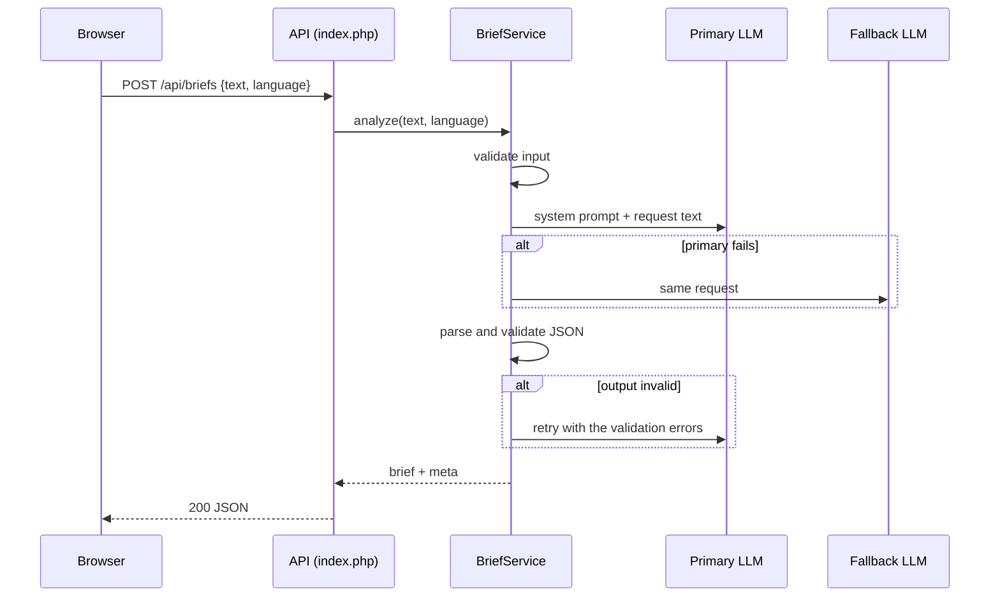

# Brief Analyzer: Project Documentation

Version 0.1 (MVP). This document explains **what** the system does, **why** it was built this way, and **how** to operate and extend it. For a quick start, see the [README](../README.md).

## Contents

1. [Purpose and scope](#1-purpose-and-scope)
2. [Requirements](#2-requirements)
3. [Architecture](#3-architecture)
4. [Design decisions](#4-design-decisions)
5. [Data contract](#5-data-contract)
6. [API reference](#6-api-reference)
7. [Prompt design](#7-prompt-design)
8. [Reliability and error handling](#8-reliability-and-error-handling)
9. [Security and privacy](#9-security-and-privacy)
10. [Front end](#10-front-end)
11. [Configuration](#11-configuration)
12. [Deployment and operations](#12-deployment-and-operations)
13. [Testing](#13-testing)
14. [Troubleshooting](#14-troubleshooting)
15. [Known limitations and roadmap](#15-known-limitations-and-roadmap)
16. [Glossary](#16-glossary)

## 1. Purpose and scope

**Problem.** Clients describe ad work informally ("a few videos for TikTok, ready by the 25th"). Teams then lose time asking for basic details such as format, objective, audience, and deadline.

**Solution.** A web page where someone pastes the request. An LLM extracts a structured brief and lists what is still unknown, so the team can ask the client the right questions at once.

**In scope (MVP):** free-text input, structured extraction, missing-information questions, editing, export as JSON or text, short browser-side history.

**Out of scope (MVP):** user accounts, database, saved briefs, file uploads, sending anything to the client, multi-language UI.

## 2. Requirements

### Functional

| ID | Requirement |
|---|---|
| F1 | The user submits a free-text request (up to 2000 characters). |
| F2 | The system returns a structured brief that follows the schema in section 5. |
| F3 | Information not stated in the request is `null`, never guessed. |
| F4 | The system lists questions for the information that is missing. |
| F5 | The user can edit every field and remove deliverables before confirming. |
| F6 | The user can answer the questions and re-run the analysis. |
| F7 | The user can copy the brief as JSON or as plain text. |
| F8 | The last 5 requests are kept in the browser. |

### Non-functional

| ID | Requirement | How it is met |
|---|---|---|
| N1 | Zero cost | Free LLM tiers and free hosting |
| N2 | Resilience to provider failures | Fallback provider, one retry on invalid output |
| N3 | Output validity | Strict schema validation on the server |
| N4 | Privacy | Request text is never logged |
| N5 | Portability | Docker image, any OpenAI-compatible provider |
| N6 | Accessibility | Labeled fields, keyboard use, status announcements, dark mode |

## 3. Architecture

A single deployable unit: one PHP process that serves both the API and the static front end.

```
public/        Entry point (index.php), pages (index.html, error.html)
src/           Application code (namespace App)
tests/         PHPUnit tests (namespace Tests)
Dockerfile     Multi-stage build
render.yaml    Hosting blueprint
```

| Component | Responsibility |
|---|---|
| `public/index.php` | Routing, request parsing, mapping exceptions to HTTP errors, logging |
| `BriefService` | Input validation, calling the LLM, parsing, validating, retrying |
| `BriefValidator` | Checks the model output against the schema |
| `Prompt` | Builds the system prompt and the user message |
| `LlmClient` (interface) | One method: `complete(system, user)` returns text and provider name |
| `OpenAiCompatibleClient` | Calls any OpenAI-style `/chat/completions` endpoint over cURL |
| `FallbackClient` | Tries clients in order, moves on when one fails |

### Request lifecycle



## 4. Design decisions

| Decision | Reason | Trade-off |
|---|---|---|
| No PHP framework | Tiny surface (2 routes), fewer moving parts, easy to read | Manual routing and error mapping |
| OpenAI-compatible client with configurable base URL | Switch provider by editing `.env`; many free providers use this format | Provider-specific features are not used |
| Validate output on the server | LLMs sometimes return malformed or off-schema JSON | Extra code and one possible retry |
| `null` instead of guessing | A wrong guess in a brief costs more than a question | More questions shown to the user |
| `confidence` as `low/medium/high` | Models are poor at calibrated numbers; the UI needs a simple signal | Less granular |
| `other` value for platform and format | A request for an unlisted platform must not break validation | Weaker typing for those cases |
| Specs kept as free text | Platform specs change often | No automatic spec checking |
| Editable results | The AI will make mistakes; the human decides | More UI code |
| No database | MVP scope; zero cost; nothing sensitive stored | No saved briefs |
| Vanilla JS, no build step | Nothing to install or compile; served by the same process | No component framework |
| Static pages served by `index.php` | One process, one origin, no CORS needed in production | Not suited for heavy traffic |

## 5. Data contract

Top level of a successful response: `id`, `brief`, `meta`.

### `brief`

| Field | Type | Rules |
|---|---|---|
| `summary` | string | Required, non-empty |
| `objective` | string or null | `awareness`, `traffic`, `leads`, `sales` |
| `audience` | string or null | Free text |
| `deliverables` | list | Required (may be empty). Items below |
| `missing_info` | list of strings | Questions for the client (defaults to empty) |
| `confidence` | string | Required: `low`, `medium`, `high` |

### `deliverables[]`

| Field | Type | Rules |
|---|---|---|
| `platform` | string | Required: `meta`, `tiktok`, `google_ads`, `other` |
| `format` | string | Required: `video`, `static`, `carousel`, `search_ad`, `other` |
| `specs` | string or null | Free text (size, duration) |
| `copy_notes` | string or null | Free text |
| `deadline` | string or null | `YYYY-MM-DD`, must be a real calendar date |

### `meta`

| Field | Meaning |
|---|---|
| `provider` | Model that produced the answer |
| `latency_ms` | Total time for the analysis |
| `retried` | `true` if the first answer was invalid and a retry was needed |
| `fallback_used` | `true` if the fallback provider answered |

## 6. API reference

### `POST /api/briefs`

Request body:

| Field | Type | Rules |
|---|---|---|
| `text` | string | Required, trimmed, 1 to 2000 characters |
| `language` | string | `pt-BR` (default) or `en`. Sets the language of `summary` and `missing_info` |

Responses:

| Status | `error.code` | When | Retryable |
|---|---|---|---|
| 200 | | Valid brief | |
| 400 | `invalid_input` | Bad body, empty or too long text, unsupported language | no |
| 422 | `invalid_output` | The model failed schema validation twice | yes |
| 429 | `llm_unavailable` | Provider rate limit | yes |
| 502 | `llm_unavailable` | Provider error or timeout on all configured providers | yes |
| 500 | `internal_error`, `server_misconfigured` | Unexpected error, or no provider configured | no |

Error body: `{ "error": { "code": "...", "message": "...", "retryable": true } }`

### `GET /api/health`

Returns `200 {"status":"ok"}`. Used by hosting health checks.

### Other paths

Any path outside `/api/` serves `index.html` for `/`, or `error.html` with status 404 for anything else. Only `.html` files are served.

## 7. Prompt design

The system prompt (`src/Prompt.php`) sets these rules:

- Reply with one JSON object only, no markdown fences.
- Use `null` for anything not stated. Never invent.
- Put each important gap in `missing_info` as a question. Ask at most 5, only about what blocks production, in plain language.
- Write `summary` and `missing_info` in the requested language.
- Dates use `YYYY-MM-DD`. The current date is injected (São Paulo timezone). A date with day and month but no year becomes the next occurrence. If day or month is missing, use `null`.
- The JSON shape and the allowed values are listed in the prompt.

**Prompt injection defense.** The client's text is wrapped in `<request>` tags, any closing tag inside it is removed, and the prompt states that the content is data, not instructions. This reduces but does not eliminate the risk, which is why the output is also validated against the schema.

**Retry prompt.** On invalid output, the second call repeats the request and adds the list of validation errors.

## 8. Reliability and error handling

| Failure | Handling |
|---|---|
| Provider returns HTTP error, times out, or has no network | Next provider in the chain. If all fail: 429 (if the last status was 429) or 502 |
| Output is not JSON, or has fences | Fences are stripped. If still invalid: one retry |
| Output fails the schema | One retry with the errors. If it fails again: 422 |
| Provider rejects `response_format` | Remove that option in `OpenAiCompatibleClient` (the validator still protects the output) |
| Front end cannot reach the API, or gets a 500 | Redirect to `error.html` |
| 400, 422, 429, 502 | Shown inline, with a retry button when retryable, input preserved |

Not implemented yet: automatic retry with backoff for 429 and 503 before moving to the next provider.

## 9. Security and privacy

| Topic | Approach |
|---|---|
| Secrets | API keys live in environment variables only. `.env` is git-ignored and excluded from the image |
| Logging | Only metadata is logged (event, provider, latency, status). Request text is never logged |
| Third-party processing | Text is sent to the AI provider. Free tiers may use prompts for training, so use fake or anonymized data |
| Prompt injection | Delimiters plus rules plus output validation (section 7) |
| XSS | The front end escapes every model-produced value before inserting it into the page |
| Path handling | Static serving rejects paths containing `..` and serves only `.html` files |
| Container | Runs as a non-root user |
| Abuse | A public URL lets anyone spend the provider quota. Share the link only with intended viewers |
| Browser storage | Recent requests are stored in `localStorage` on the user's device |

## 10. Front end

A single page (`index.html`, no build step) and an error page (`error.html`).

- **States:** empty, loading (skeleton), result, inline error, error page.
- **Editing:** every field edits the in-memory brief. Any edit removes the "confirmed" state.
- **Missing information:** answers are appended to the original text under "Informações adicionais" and sent as a new analysis.
- **Export:** JSON of the edited brief, or a plain-text summary.
- **History:** last 5 requests with their results in `localStorage` (key `ba_hist`).
- **Design:** one accent color, amber reserved for "needs attention", light and dark themes, 44px minimum touch targets.
- **API location:** `const API=''` (same origin). Change it when serving the page from another origin, and set `CORS_ORIGIN` on the server.

## 11. Configuration

| Variable | Required | Description |
|---|---|---|
| `LLM_BASE_URL` | yes | Base URL of an OpenAI-compatible API |
| `LLM_API_KEY` | yes | API key |
| `LLM_MODEL` | yes | Model name as listed by the provider |
| `LLM_FALLBACK_BASE_URL`, `LLM_FALLBACK_API_KEY`, `LLM_FALLBACK_MODEL` | no | Second provider |
| `CORS_ORIGIN` | no | Allowed origin for cross-origin use (default `*`) |
| `PORT` | hosting | Must match the Dockerfile (`8080`) |

A provider is used only if its base URL, key, **and** model are all set. A missing or misspelled variable silently disables that provider.

## 12. Deployment and operations

### Build and run

```bash
docker build -t brief-analyzer-api .
docker run --rm -p 8080:8080 --env-file .env brief-analyzer-api
```

The image is multi-stage: Composer installs production dependencies in the first stage, and the runtime stage copies only `vendor/`, `src/`, and `public/`. `.env` is never baked in, so changing it needs a new container, not a new image. Changing code needs a rebuild.

### Hosting

`render.yaml` is a Render Blueprint: a Docker web service on the free plan, with health check `/api/health`. API keys are marked `sync: false` and entered in the dashboard.

Free plans sleep after inactivity, so the first request can take about a minute. Wake the service before a demo.

### Observability

One JSON line per event on stderr:

| Event | Fields |
|---|---|
| `brief_ok` | `provider`, `latency_ms`, `retried`, `fallback_used` |
| `brief_invalid_output` | `reason` |
| `llm_error` | `status`, `reason` |
| `unexpected_error` | `reason` |

The same metadata is returned in `meta` on every success.

### CI

GitHub Actions: install dependencies, run the tests, then build the Docker image.

## 13. Testing

### Automated (PHPUnit, LLM mocked)

| Area | Cases |
|---|---|
| `BriefService` | valid output, fenced JSON, retry on invalid output, failure after retry, unknown platform, impossible date, empty input (no LLM call), input too long |
| `FallbackClient` | uses next provider on failure, no fallback flag when the first works, throws when all fail |

```bash
composer test
```

### Manual test plan (against the running app)

| # | Scenario | Expected |
|---|---|---|
| M1 | Complete request | 200, deliverables for each platform, objective and audience filled, deadline as `YYYY-MM-DD`, at most 2 questions, confidence medium or high |
| M2 | Vague request ("Faz uns anúncios aí pra divulgar a loja") | 200, mostly `null`, no invented platform or date, 3 to 5 questions, confidence low, empty fields highlighted |
| M3 | Date handling | "10/12" becomes next 10 December. "dia 25" stays `null`. A full date with year is kept |
| M4 | Answer and re-analyze | New result with more fields filled and fewer questions, original text preserved plus the answers |
| M5 | Prompt injection | A request telling the model to ignore its rules still returns a valid brief, never the injected reply |

## 14. Troubleshooting

| Symptom | Likely cause | Fix |
|---|---|---|
| `llm_unavailable` right away | Provider variable misspelled or missing (for example `LLM_APY_KEY`), so only the fallback is active | Fix the variable name, restart |
| Google returns 503 "high demand" | Provider overloaded (not a quota problem) | Use another primary provider, keep Google as fallback |
| `model_not_found` | Model name retired or not available to the key | List models with the provider's `/models` endpoint |
| `{"error":"Route not found"}` at `/` | Container built from an older version | Rebuild the image |
| `.env` changes ignored | Environment is read at startup | Recreate the container (`docker restart` is not enough) |
| `curl` works but no logs in the terminal | Another process is answering on port 8080 | `ss -ltnp \| grep 8080`, stop it |
| Page redirects to the error page | Front end cannot reach the API, or opened from `file://` | Open the app through the server URL |
| First request very slow in production | Free plan was asleep | Open the page a few minutes earlier |

## 15. Known limitations and roadmap

**Limitations:** the AI can misread requests, no persistence, no authentication, the built-in PHP server is not meant for heavy traffic, spec values are not validated.

**Roadmap, by value:**
1. Retry with backoff on 429 and 503
2. Startup warning when a provider is not fully configured
3. Larger automated evaluation set (messy, complete, English, adversarial requests)
4. Access code and rate limiting for public deployments
5. Saved briefs (SQLite) and PDF export
6. Per-platform spec checks from a config file

## 16. Glossary

| Term | Meaning |
|---|---|
| Creative | The content of an ad: video, image, carousel, or text |
| Brief | A structured description of the creative work to produce |
| Deliverable | One creative asset for one platform and format |
| LLM | Large language model |
| OpenAI-compatible | An API that follows the OpenAI chat completions format |
| Fallback | A second provider used when the first one fails |
| Prompt injection | Text that tries to override the model's instructions |
