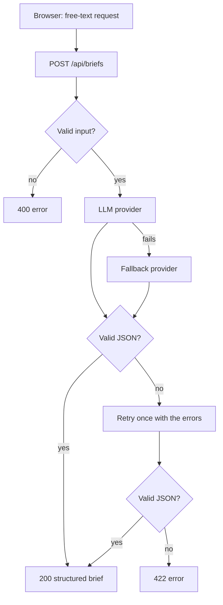

# Brief Analyzer

Turn loose, unstructured client requests for digital ads into clear, structured creative briefs.

Clients rarely send a proper brief. They write things like *"I need a few short videos for TikTok and Instagram to promote the Black Friday sale, ready by the 25th."* Brief Analyzer reads that kind of free text with an LLM and returns a structured brief (platforms, formats, specs, deadlines) plus the **questions that are still missing**, so the team knows what to ask the client before starting work.

> The interface is in Brazilian Portuguese. The API also accepts English requests.

**Live demo:** `https://brief-anal.onrender.com` (hosted on a free plan: the first load after a period of inactivity can take about a minute while the server wakes up)

<!-- Add a screenshot here:  -->

## Features

- Free-text input with no template required (Meta, TikTok, Google Ads and others)
- Structured output: summary, objective, audience, and one card per deliverable
- A "missing information" block with the questions to ask the client. You can answer them and re-run the analysis
- Every field is editable before you confirm, because the AI can be wrong
- Copy the result as JSON or as plain text
- Recent requests saved in the browser (stored locally, never sent to a database)
- Clear loading, error, and "page not found" states

## How it works



The model is asked to return JSON only. The backend then checks that JSON against a strict schema (allowed values, real dates, correct types). If the answer is invalid, it asks the model once more, passing the validation errors. Anything the request does not state comes back as `null` instead of being guessed.

## Quick start

You need **one** API key from any OpenAI-compatible provider. Several have free tiers, for example [Groq](https://console.groq.com) or [Google AI Studio](https://aistudio.google.com).

### Option 1: Docker

```bash
cp .env.example .env      # then edit .env and add your key
docker build -t brief-analyzer-api .
docker run --rm -p 8080:8080 --env-file .env brief-analyzer-api
```

### Option 2: PHP locally (PHP 8.2+ with the curl and mbstring extensions)

```bash
composer install
cp .env.example .env      # then edit .env and add your key
composer start
```

Then open **http://localhost:8080**.

Do not put quotes around the values in `.env`. If you change `.env`, restart the server (or recreate the container), because it is read at startup.

## Configuration

| Variable | Required | Description |
|---|---|---|
| `LLM_BASE_URL` | yes | Base URL of an OpenAI-compatible API |
| `LLM_API_KEY` | yes | Your API key |
| `LLM_MODEL` | yes | Model name, as listed by your provider |
| `LLM_FALLBACK_BASE_URL`, `LLM_FALLBACK_API_KEY`, `LLM_FALLBACK_MODEL` | no | Second provider, used when the first one fails or is rate limited |
| `CORS_ORIGIN` | no | Only needed if the front end is served from a different origin |

Free tiers are capped and sometimes overloaded, which is why a fallback provider is supported. Model names and limits change over time, so check your provider's documentation.

## API

### `POST /api/briefs`

Request:

```json
{
  "text": "I need 3 short TikTok videos for the Black Friday sale, ready by the 25th.",
  "language": "en"
}
```

`text` is required (up to 2000 characters). `language` is `pt-BR` (default) or `en`.

Response `200`:

```json
{
  "id": "brf_0e7071de",
  "brief": {
    "summary": "string",
    "objective": "awareness | traffic | leads | sales | null",
    "audience": "string | null",
    "deliverables": [
      {
        "platform": "meta | tiktok | google_ads | other",
        "format": "video | static | carousel | search_ad | other",
        "specs": "string | null",
        "copy_notes": "string | null",
        "deadline": "YYYY-MM-DD | null"
      }
    ],
    "missing_info": ["string"],
    "confidence": "low | medium | high"
  },
  "meta": {
    "provider": "model name",
    "latency_ms": 984,
    "retried": false,
    "fallback_used": false
  }
}
```

Errors use one shape:

```json
{ "error": { "code": "invalid_output", "message": "...", "retryable": true } }
```

| Status | Meaning |
|---|---|
| 400 | Invalid input (empty text, too long, wrong language) |
| 422 | The model could not produce a valid brief, even after a retry |
| 429 | The AI provider rate limit was reached |
| 502 | The AI provider is unavailable |
| 500 | Unexpected server error |

### `GET /api/health`

Returns `{"status":"ok"}`.

## Tests

```bash
composer test
```

The LLM is replaced by a fake in the tests, so they run offline and never use your API quota. They cover schema validation, the retry logic, fenced JSON, input limits, and the provider fallback. GitHub Actions runs them on every push and also builds the Docker image.

## Project structure

```
public/
  index.php        Router: API routes and static pages
  index.html       Main screen (plain HTML, CSS and JS, no build step)
  error.html       Error and 404 page
src/
  BriefService     Validation, LLM call, retry
  BriefValidator   Output schema checks
  Prompt           System prompt
  OpenAiCompatibleClient, FallbackClient
tests/             PHPUnit tests with a fake LLM
Dockerfile
render.yaml        Deploy blueprint for Render
```

## Privacy

Request text is sent to the configured AI provider and is **not** logged by this app, only metadata such as provider, latency, and whether a retry happened. Free tiers of AI providers may use prompts for training, so do not send real client data to a free tier. Use fake or anonymized requests.

## Limitations

- Built as an MVP: no accounts, no database, no saved briefs
- The built-in PHP server is fine for a demo. Put a production web server in front of it for real use
- Platform specs (sizes, durations) are kept as free text and not validated, because they change often
- The AI can misread a request. That is why every field is editable and low confidence is flagged

## Ideas for next steps

- Saving and sharing confirmed briefs
- Export to PDF or to a project management tool
- Per-platform spec checks
- A simple access code and rate limiting for public deployments

## Tech stack

PHP 8.3, vanilla JavaScript, PHPUnit, Docker, GitHub Actions, Render, any OpenAI-compatible LLM API.
